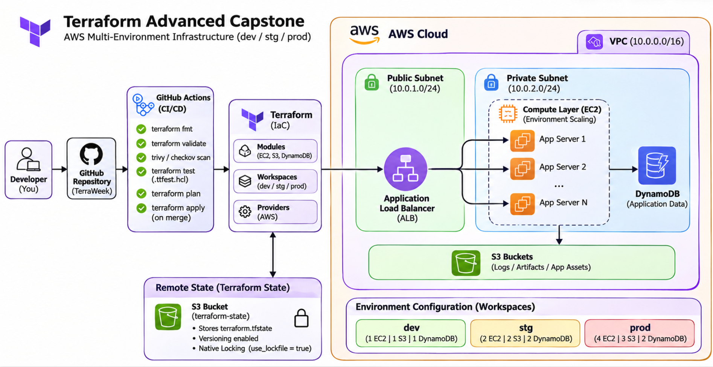

# Terraform AWS Multi-Environment Infrastructure

A Terraform portfolio project for managing separate **development, staging, and production** infrastructure from one reusable AWS configuration.

The project uses Terraform workspaces to select an environment, reusable modules to organize resources, an S3 backend for remote state storage, and GitHub Actions to run configuration checks and Terraform tests.

> **Project status:** This README describes the intended configuration and workflow. Add deployment evidence only after the corresponding resources and checks have actually succeeded in your AWS account.

## Project Overview

| Environment | EC2 instances | Application S3 buckets | DynamoDB tables |
| :---------- | ------------: | ---------------------: | --------------: |
| `dev`       |             1 |                      1 |               1 |
| `stg`       |             2 |                      2 |               2 |
| `prod`      |             4 |                      3 |               2 |

The resource counts are selected from the active Terraform workspace. The remote-state S3 bucket is separate and is not included in the application bucket totals.

## Architecture



The project follows this workflow:

1. A developer updates Terraform configuration and pushes changes to GitHub.
2. GitHub Actions checks formatting, initializes Terraform, validates the configuration, and runs the Terraform tests.
3. Terraform selects the environment-specific resource counts using the active workspace.
4. Reusable modules manage EC2 instances, application S3 buckets, and DynamoDB tables.
5. Terraform state is stored in an S3 backend, with native S3 state locking enabled.

The architecture diagram and implementation screenshots are stored in `docs/screenshots/`.

## Repository Structure

```text
.
├── .github/
│   └── workflows/
│       └── terraform.yml
│
├── modules/
│   ├── ec2/
│   │   ├── main.tf
│   │   ├── variables.tf
│   │   └── outputs.tf
│   │
│   ├── s3/
│   │   ├── main.tf
│   │   ├── variables.tf
│   │   └── outputs.tf
│   │
│   └── dynamodb/
│       ├── main.tf
│       ├── variables.tf
│       └── outputs.tf
│
├── tests/
│   ├── infrastructure.tftest.hcl
│   └── test_public_key.pub
│
├── docs/
│   └── screenshots/
│       ├── architecture.png
│       ├── 01-terraform-init.png
│       ├── 02-stg-test.png
│       ├── 03-dev-test.png
│       └── 04-prod-test.png
│
├── main.tf
├── variables.tf
├── locals.tf
├── data.tf
├── outputs.tf
├── providers.tf
├── terraform.tf
├── backend.tf
├── .gitignore
├── README.md
└── .terraform.lock.hcl
```

## Configuration Guide

| File or directory    | Responsibility                                                                     |
| :------------------- | :--------------------------------------------------------------------------------- |
| `main.tf`            | Connects the reusable modules to the root configuration.                           |
| `locals.tf`          | Defines resource counts for each environment and selects the active configuration. |
| `variables.tf`       | Declares configurable input values.                                                |
| `data.tf`            | Retrieves existing AWS information, such as an AMI, when permitted.                |
| `providers.tf`       | Configures the AWS provider and target region.                                     |
| `terraform.tf`       | Defines Terraform and provider requirements.                                       |
| `backend.tf`         | Configures remote state storage and native locking.                                |
| `outputs.tf`         | Exposes useful infrastructure information.                                         |
| `modules/`           | Holds the EC2, S3, and DynamoDB module implementations.                            |
| `tests/`             | Contains Terraform configuration tests.                                            |
| `.github/workflows/` | Contains the automated validation workflow.                                        |
| `docs/screenshots/`  | Holds the architecture diagram and implementation screenshots.                     |

## Technology Stack

- Terraform and HashiCorp Configuration Language (HCL)
- AWS provider
- Amazon EC2
- Amazon S3
- Amazon DynamoDB
- Terraform CLI workspaces
- Reusable Terraform modules
- Terraform native testing
- GitHub Actions

## Prerequisites

Before using this project, prepare:

- Terraform CLI.
- AWS CLI.
- AWS credentials with the necessary service permissions.
- An existing S3 bucket for remote Terraform state.
- An SSH public key if the EC2 module registers an AWS key pair.
- An approved AMI ID for the target AWS region, if supplied as an input.

Check your local setup:

```bash
terraform version
aws sts get-caller-identity
aws configure get region
```

### SSH Key Setup

Generate an SSH key pair if you do not already have one:

```bash
ssh-keygen -t ed25519 -f ~/.ssh/terraform-aws-key \
  -C "terraform-aws-capstone"
```

Set the public-key path in your Terraform variables:

```hcl
key_public_path = "~/.ssh/terraform-aws-key.pub"
```

The EC2 module should expand the home-directory path before reading the key:

```hcl
public_key = file(pathexpand(var.key_public_path))
```

Keep the private key outside the repository. Terraform only needs the public key for AWS key-pair registration.

## Remote State Configuration

The S3 bucket used for Terraform state must be created before the first `terraform init`.

Prepare the bucket with:

- Versioning enabled.
- Public access blocked.
- Encryption enabled.
- Appropriate permissions for state files and lock files.

Example `backend.tf` configuration:

```hcl
terraform {
  backend "s3" {
    bucket               = "REPLACE_WITH_YOUR_STATE_BUCKET"
    key                  = "terraform.tfstate"
    region               = "ap-southeast-2"
    encrypt              = true
    use_lockfile         = true
    workspace_key_prefix = "env"
  }
}
```

The workspace state objects follow this pattern:

| Workspace | S3 object key                |
| :-------- | :--------------------------- |
| `dev`     | `env/dev/terraform.tfstate`  |
| `stg`     | `env/stg/terraform.tfstate`  |
| `prod`    | `env/prod/terraform.tfstate` |

The backend bucket is dedicated to Terraform state and is not part of the application S3 module.

## Getting Started

### 1. Clone the repository

```bash
git clone https://github.com/Ashish-6-24/terraform-aws-multi-env-infrastructure.git

cd terraform-aws-multi-env-infrastructure
```

### 2. Configure your local values

Review `terraform.tfvars.example` and create your own local `terraform.tfvars` where needed.

Do not commit private configuration or credentials.

### 3. Format and initialize

```bash
terraform fmt -recursive
terraform init
```

For migration from an existing local state file to the S3 backend:

```bash
terraform init -migrate-state
```

### 4. Validate the configuration

```bash
terraform validate
```

### 5. Create and select workspaces

Create each workspace once:

```bash
terraform workspace new dev
terraform workspace new stg
terraform workspace new prod
```

For workspaces that already exist, select the required one:

```bash
terraform workspace list
terraform workspace select dev
terraform workspace show
```

### 6. Run Terraform tests

Run the tests independently for each environment:

```bash
# Development
terraform workspace select dev
terraform test

# Staging
terraform workspace select stg
terraform test

# Production
terraform workspace select prod
terraform test
```

The current test file uses plan-based assertions to verify environment sizing. These tests do not apply the infrastructure, although AWS provider operations and data-source lookups may still require AWS API permissions.

### 7. Review infrastructure plans

Generate a plan for each workspace before deployment:

```bash
terraform workspace select dev
terraform plan

terraform workspace select stg
terraform plan

terraform workspace select prod
terraform plan
```

Review the planned resource counts, configuration changes, AWS region, and security rules before proceeding.

### 8. Apply the configuration

Applying Terraform creates or changes actual AWS resources and may incur charges.

Deploy one environment at a time:

```bash
terraform workspace select dev
terraform apply
```

Repeat for staging and production only when you are ready to deploy them.

## GitHub Actions

The workflow is located at:

```text
.github/workflows/terraform.yml
```

It is designed to run on pushes and pull requests targeting `main`, with an option for manual execution.

The workflow performs:

1. Terraform formatting checks.
2. Terraform initialization.
3. Configuration validation.
4. Workspace selection.
5. Terraform tests.

The CI workflow does not automatically execute `terraform apply`.

When AWS credentials are needed, configure the required GitHub Actions secrets. For a production-oriented workflow, consider GitHub OIDC role assumption instead of long-lived access keys. Make sure backend initialization and credentials are consistent with the intended CI design.

## Outputs and Verification

After a successful deployment, inspect the outputs and Terraform state:

```bash
terraform output
terraform state list
terraform workspace show
```

The EC2 module exposes these outputs:

| Output         | Description                                   |
| :------------- | :-------------------------------------------- |
| `instance_ids` | IDs of the created EC2 instances.             |
| `public_ips`   | Public IP addresses of the created instances. |

The root-level outputs depend on the declarations in `outputs.tf` and the outputs exposed by each module.

You can also verify resources through the AWS Console or AWS CLI.

## Evidence

The `docs/screenshots/` directory documents the implementation and demonstrates the results.

Recommended screenshots include:

- Overall architecture diagram.
- Terraform formatting and validation results.
- Workspace configuration.
- Test results for `dev`, `stg`, and `prod`.
- Successful GitHub Actions workflow execution.
- S3 state bucket and versioning configuration.
- Actual AWS resources for each environment after deployment.

Only include screenshots from real executions. Do not publish private keys, AWS credentials, Terraform state files, or other sensitive information.

## Security Considerations

- Restrict SSH access instead of allowing TCP port 22 from every IP address.
- Do not use unrestricted inbound rules such as all protocols from `0.0.0.0/0`.
- Keep the remote-state bucket private and versioned.
- Never commit private SSH keys or AWS credentials.
- Verify the selected AWS account and region before planning or applying changes.
- Inspect resource replacements and deletions before approving Terraform operations.

### AWS Organizations SCP Restriction

During project development, AWS returned an explicit Service Control Policy deny for `ec2:DescribeImages`.

An IAM Allow policy cannot override an applicable explicit SCP Deny.

To handle this limitation, the AWS Organizations administrator must review the applicable policy, or the project can use an approved AMI ID as an input instead of performing an AMI lookup.

Using a pre-approved AMI ID avoids the `DescribeImages` lookup only. It does not grant permission to launch EC2 instances or perform other restricted AWS operations.

## Cleanup

Destroy infrastructure one workspace at a time. First confirm which environment is selected:

```bash
terraform workspace show
terraform plan -destroy
```

When you have reviewed the deletion plan and are ready to remove that environment:

```bash
terraform destroy
```

Repeat for other workspaces only when appropriate.

Do not remove the S3 remote-state bucket until all dependent Terraform state has been safely handled.

## Future Improvements

Potential enhancements for later iterations:

- Add or refine VPC and public/private subnet configuration.
- Integrate an Application Load Balancer for application traffic.
- Restrict private EC2 ingress to the ALB security group.
- Add deeper tests for resource properties and module outputs.
- Use GitHub OIDC for AWS authentication.
- Introduce security scanning and policy checks.
- Improve production and non-production permission boundaries.

## Author

**Ashish Subedi**

- GitHub: [Ashish-6-24](https://github.com/Ashish-6-24)
